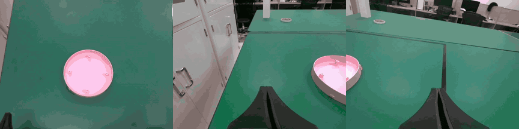
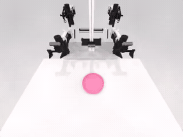
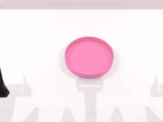
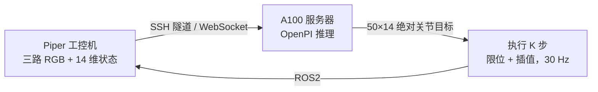

<h1 align="center">Probe0 · π₀.₅ 双臂操作</h1>

<b>RoboTwin 2.0 仿真微调 → AgileX Piper 真机部署</b> 
OpenPI / JAX · Multi-task SFT · LoRA · ROS2

  
   Piper 真机推理回合，三路模型输入相机（俯视 / 左腕 / 右腕），2× 速 · <a href="assets/probe0/media/real_piper_rollout_3cam.mp4">原始视频</a>

基于 OpenPI π₀.₅ 搭建双臂机器人从示范数据、微调、仿真闭环测评到真机部署的完整流程，并对比不同微调范围（全参 / 三种 LoRA）的效果。本项目不提出新的 VLA 架构。

| | 数据 | 结果 |
|---|---|---|
| 仿真 | RoboTwin 2.0 五任务 × 50 条示范 | 五任务平均 SR 最高 **69.2%**（每任务 100 回合） |
| 真机 | Piper 抬圆盘，30 条遥操作示范 | Default LoRA **12/20**，AE-only LoRA **8/20** |
| 新任务 | 自建 `lift_pink_plate`，50 条专家示范 | 五任务模型零样本迁移 **0/100** |

> 本仓库 fork 自 [RoboTwin](https://github.com/RoboTwin-Platform/RoboTwin)，原 README 见 [README_RoboTwin.md](README_RoboTwin.md)。

## 仿真：微调范围对比

四个模型使用同一份 250 条 clean 示范联合训练，每任务测试 100 个有效回合（H=50, K=50）。

  <picture>
    <source media="(prefers-color-scheme: dark)" srcset="assets/probe0/clean_sr_dark.svg">
    
  </picture>

- **视觉编码器是否训练决定了大部分差距**：只训 Action Expert 时平均 19.6%，加上视觉编码器后 69.2%（+49.6 pp）。
- 再加语言 LoRA（Default LoRA）没有进一步提升，两者差 1.6 pp，在单 seed、100 回合下不足以区分。

| 配方 | Vision Encoder | 语言模块 | Action Expert | 可训练参数 |
|---|---|---|---|---|
| AE-only LoRA | 冻结 | 冻结 | LoRA r32 + 动作投影 | 2,428 万（0.7%） |
| Vision Encoder + AE | 全量训练 | 冻结 | LoRA r32 + 动作投影 | — |
| Default LoRA | 全量训练 | LoRA r16 | LoRA r32 + 动作投影 | 4.67 亿（13.7%） |
| Full Finetune | 全量 | 全量 | 全量 | 全部 |

三种 LoRA：15k 步、batch 64、seed 42。全参：50k 步、batch 32、EMA 0.99，因此全参与 LoRA **不是单变量对比**。

### 域随机化

  <picture>
    <source media="(prefers-color-scheme: dark)" srcset="assets/probe0/clean_vs_dr_dark.svg">
    
  </picture>

同时改变背景、光照、杂物和桌高后，所有模型均大幅下降；全参保留得最多（31.0%），Vision + AE 跌到 12.0%。

逐任务成功率

| 任务 | AE-only | Vision + AE | Default LoRA | Full FT |
|---|---:|---:|---:|---:|
| handover_block | 7 | 46 | 51 | **70** |
| lift_pot | 15 | **98** | 96 | 93 |
| put_object_cabinet | 6 | 36 | **40** | 37 |
| place_empty_cup | 17 | 93 | **95** | 88 |
| click_alarmclock | 53 | **73** | 56 | 58 |

## 新任务：`lift_pink_plate`

把真机用的粉色圆盘（直径 20 cm、盘缘高 3 cm）从 STL 导入 RoboTwin，用分段碰撞体保留盘内凹槽，并编写双臂抓盘缘的专家脚本，生成 50 条成功示范。成功判据：盘升高 ≥ 8 cm 且基本水平。

| 专家示范（成功） | 五任务 SFT 模型零样本（失败） |
|:-:|:-:|
|  |  head camera，8× 速 |

同为双臂抬起任务，训练内的 `lift_pot` 达到 91–98%，但五个已有模型（联合 / 单任务、全参 / LoRA）在圆盘上全部 **0/100**（上方视频中夹爪始终在盘上方徘徊，未夹住盘缘）。专家脚本能成功，说明问题不在环境本身——新的接触几何需要任务专属示范，因此真机阶段采集了 30 条示范单独微调。

## 真机：Piper 双臂抬圆盘

指令：`Grab the pink disk and lift it together.`

| 模型 | 成功 / 尝试 | SR |
|---|:-:|:-:|
| Default LoRA | 12 / 20 | **60%** |
| AE-only LoRA | 8 / 20 | 40% |

两个模型均用 30 条示范（17,903 帧，三路相机）训练 15k 步、batch 64。差距方向与仿真一致，但每组仅 20 次，样本量较小。

端到端推理平均 0.206 s；三路相机最大时间戳偏差 0.031 s。仿真用 Aloha-AgileX 且动作为关节 delta，真机用 14 维绝对目标，两套归一化分开。真机模型只用真机数据训练，未验证 sim-to-real 直接迁移。

## 待补充

- 仿真五任务 rollout 集锦，以及按失败类型（未抓到 / 交接掉落 / 双臂不同步 / 放置偏差）分类的片段
- 真机外部全景视频（成功与失败各若干）
- 训练、评测与部署脚本整理后的复现说明

## 致谢

基于 [OpenPI](https://github.com/Physical-Intelligence/openpi) 与 [RoboTwin](https://github.com/RoboTwin-Platform/RoboTwin)，各组件保留其上游许可证。
