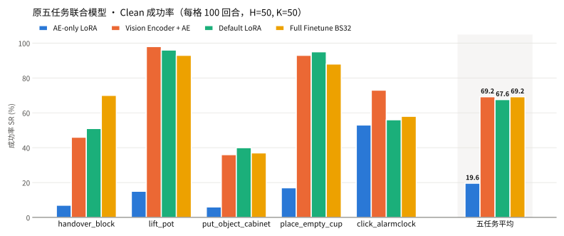
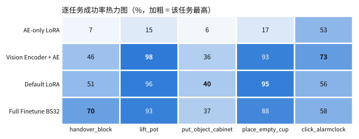
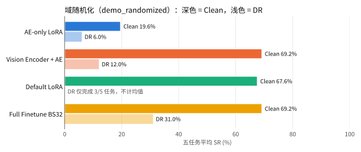
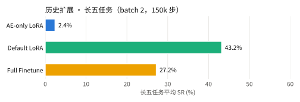
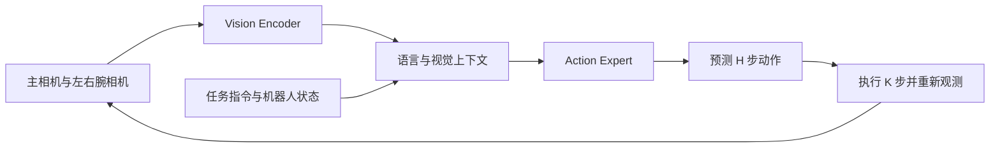
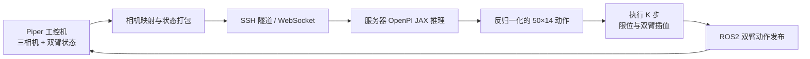

<h1 align="center">Probe0 · π₀.₅ 双臂操作</h1>
<p align="center"><b>从 RoboTwin 仿真微调到 AgileX Piper 真机部署</b></p>

<p align="center">
  
  
  
  
  
</p>

基于开源 OpenPI π₀.₅，搭建双臂机器人从**示范数据 → 监督微调 → 仿真闭环测评 → 真机推理部署**的完整实验流程，并比较不同微调范围在任务成功率、视觉扰动和新任务迁移上的表现。

| 🧪 仿真 | 🦾 真机 | 🧩 新任务 |
|---|---|---|
| 5 任务 × 50 = **250 条**专家演示联合微调<br>4 种配方 × 5 任务 × **100 回合**闭环测评 | **30 条**遥操作演示（17,903 帧，三路图像）<br>训练双臂抬盘模型，完成推理链路部署 | 实物圆盘 STL → RoboTwin 任务 `lift_pink_plate`<br>**50 条**双臂专家示范 + 迁移测试 |

> [!NOTE]
> 本项目**不提出新的 VLA 架构**，主要工作是数据与机器人接口适配、微调配方对照、任务环境构建和可追溯的部署测评。
> 仿真正式结果已整理，视频尚待筛选上传；真机训练、离线推理及部分动作链路测试已完成，完整抬盘 Demo 与真机成功率待补充。下文只报告已核实结果，**不把控制循环次数当作任务成功次数**。

> 本仓库 fork 自 [RoboTwin](https://github.com/RoboTwin-Platform/RoboTwin)，原项目 README 见 [README_RoboTwin.md](README_RoboTwin.md)。

---

## 📊 核心结果一览

<p align="center">
  <picture>
    <source media="(prefers-color-scheme: dark)" srcset="assets/probe0/clean_sr_dark.svg">
    
  </picture>
</p>

**三点观察：**

1. **视觉适配是关键。** 相同数据与 LoRA 训练预算下，解冻视觉编码器后平均 SR 从 19.6% 提升到 69.2%（**+49.6 pp**）。
2. **LoRA 配方之间差距很小。** Vision + AE 与 Default LoRA 只差 1.6 pp，不足以证明前者稳定更优，也不能据此断言语言适配无作用。
3. **Clean 成功 ≠ 鲁棒。** 加入域随机化后所有模型都明显下降（见下图）。

<details>
<summary><b>逐任务热力图 & 原始数值表</b></summary>
<br>

<p align="center">
  <picture>
    <source media="(prefers-color-scheme: dark)" srcset="assets/probe0/clean_heatmap_dark.svg">
    
  </picture>
</p>

| 任务 | AE-only LoRA | Vision Encoder + AE | Default LoRA | Full Finetune BS32 |
|---|---:|---:|---:|---:|
| handover_block | 7% | 46% | 51% | **70%** |
| lift_pot | 15% | **98%** | 96% | 93% |
| put_object_cabinet | 6% | 36% | **40%** | 37% |
| place_empty_cup | 17% | 93% | **95%** | 88% |
| click_alarmclock | 53% | **73%** | 56% | 58% |
| **五任务平均 SR** | **19.6%** | **69.2%** | **67.6%** | **69.2%** |

</details>

### 域随机化：Clean 成功不等于鲁棒

<p align="center">
  <picture>
    <source media="(prefers-color-scheme: dark)" srcset="assets/probe0/clean_vs_dr_dark.svg">
    
  </picture>
</p>

DR 使用 `demo_randomized` 的混合变化，综合分数**不解释为**独立的颜色、语言或未见物体泛化能力。Default LoRA 本次仅核实到三项完整 DR 结果，故不计五任务均值。

> [!IMPORTANT]
> **解释边界**
> - 单训练 seed，各组 100 回合；历史有效场景与语言指令不完全配对。只报告观测差异，不宣称统计显著性或模块因果贡献。
> - 全参 BS32 与 LoRA 的步数、batch、seed、EMA 均不同，全参列是**另一种训练预算下的基线**，不是单变量消融。
> - 任务子集不等于完整 RoboTwin 50 任务榜单。

<details>
<summary><b>历史扩展：长任务与重规划频率</b></summary>
<br>

另完成五个较长任务的联合微调与测评：`put_bottles_dustbin`、`stack_blocks_three`、`stack_bowls_three`、`blocks_ranking_size`、`hanging_mug`，每任务 50 条示范。

<p align="center">
  <picture>
    <source media="(prefers-color-scheme: dark)" srcset="assets/probe0/long_tasks_dark.svg">
    
  </picture>
</p>

以上为历史 batch 2、150k 步实验，不与首页 15k LoRA 配方混为同一预算。历史原五任务联合全参还完成固定 H=50 的 K 消融：K15 / K25 / K50 平均 SR 分别为 **61.8% / 61.0% / 59.8%**，未观察到对所有任务都一致的改善。

</details>

---

## 🎬 Demo Gallery

### 1. 仿真：五类任务的闭环操作

从顺序交接、同步共举，到开柜放物和单臂主导操作，观察同一策略如何根据图像、状态与指令产生双臂动作。

| 任务 | 动作过程 | 展示模型 | Clean SR |
|---|---|---|---:|
| `handover_block` | 左臂抓取 → 双臂交接 → 右臂放置 | Full Finetune BS32 | 70/100 |
| `lift_pot` | 双臂接近把手 → 同步抓取与抬升 | Vision Encoder + AE | 98/100 |
| `put_object_cabinet` | 打开柜门 → 抓取物体 → 放入柜内 | Default LoRA（15k） | 40/100 |
| `place_empty_cup` | 抓取杯子 → 放到杯垫 | Default LoRA（15k） | 95/100 |
| `click_alarmclock` | 接近闹钟 → 按压按钮 | Vision Encoder + AE | 73/100 |

> 🎞️ **视频待上传**：五任务集锦与逐任务片段。上表是**不同模型**的展示素材，并非同一模型的成功集锦。

<!-- 发布时：在此粘贴实际上传的视频地址，或插入已加入仓库的 GIF/封面。
建议素材命名：assets/probe0/media/sim_five_tasks.mp4、sim_five_tasks.gif。
每个片段注明 task、model、environment、seed、H/K、最终结果与播放倍速。
展示片段可选成功回合，但 SR 必须来自完整 100 回合，不能由精选视频估计。 -->

<details>
<summary>计划：同一任务，不同 LoRA 配方并排对比</summary>

优先选择 `lift_pot` 或 `handover_block`，并排展示 AE-only、Vision Encoder + AE、Default LoRA 的成功与失败行为，使用共同场景种子并保留各自真实结果。

历史录像主要为 `head_camera` 视角（通常 320×240、10 fps），是模型观察视角而非全景，机械臂可能遮挡动作过程。

</details>

### 2. 真机：Piper 双臂抬粉色圆盘

**任务指令：** `Grab the pink disk and lift it together.`

> 🎞️ **视频待补充**：外部全景完整呈现「观测 → 双臂接近 → 抓取盘缘 → 抬升」，可叠加前相机与左右腕相机小窗。

<!-- 发布时替换为实际素材：assets/probe0/media/real_piper_lift_plate.mp4。
完整任务尚未确认成功前，可先发布动作链路测试，但标题必须写 "Deployment / motion test"。
不要用专家遥操作视频代替模型执行视频。 -->

**部署进度**

| | 阶段 | 内容 |
|:-:|---|---|
| ✅ | 示范采集 | 30 条真实遥操作轨迹，17,903 帧、三路图像 |
| ✅ | 模型训练 | AE-only LoRA 与 Default LoRA，各 15,000 步，batch 64 |
| ✅ | 模型加载 | 两组最终权重均通过加载与离线推理检查 |
| ✅ | 动作输出 | 每次预测 50×14 动作 chunk（14 维绝对关节／夹爪目标） |
| ✅ | 现场部署 | 工控机处理 ROS2 观测与动作发布，服务器 JAX 推理，SSH 隧道通信 |
| 🟡 | 现场链路 | AE-only 已有 dry-run、单臂／双臂短时动作与 chunk 执行记录 |
| ⏳ | 完整任务评测 | 待补充独立尝试次数、成功数、接管记录与视频；**目前不报告真机 SR** |

> [!WARNING]
> 现场记录中的「20/20、50/50」是推理或控制循环完成次数，**不是**抬盘成功次数。Default LoRA 已通过离线检查，尚无已核实的现场完整任务结果。

### 3. 自建仿真任务：`lift_pink_plate`

将实物圆盘 STL 转成 RoboTwin 任务，检查已训练策略能否迁移到新的接触几何。

- 📐 直径 **20 cm**、盘缘高 **3 cm**、底板厚 **4 mm**；盘底贴桌、开口朝上。
- 🧱 用底板 + 分段薄壁组合碰撞体保留凹槽，修复单一凸包填满盘内空间的问题。
- 🤖 构建双臂抓盘专家，完成 **50 条示范**（HDF5、规划轨迹、头部与全景视频）。
- ✔️ 按任务判据验证抬升高度、姿态和双臂 TCP 邻近条件；未做实物质量／摩擦的系统标定。

**零样本迁移测试（均未使用圆盘示范微调）**

| 模型 | 来源 | SR |
|---|---|:-:|
| Full Finetune BS32 | 原五任务联合 | 0/100 |
| Vision Encoder + AE | 原五任务联合 | 0/100 |
| Default LoRA（历史） | 原五任务联合 | 0/100 |
| Full Finetune | lift_pot 单任务 | 0/100 |
| LoRA | lift_pot 单任务 | 0/100 |

结果说明当前设置下**未观察到成功迁移**，而非证明模型在该任务上无法学习。

> 🎞️ **视频待上传**：专家全景 Demo + 已有模型的迁移失败片段（专家演示与模型 rollout 分开标注）。

---

## 🛠️ 方法与实现

### π₀.₅ 如何产生动作

视觉编码器处理多视角图像，语言模块结合任务指令与状态上下文，Action Expert 通过 flow matching 生成连续动作 chunk。部署时执行其中 K 步，再获取新观测并重规划。



### 三种 LoRA 配方更新了什么

> ❄️ 冻结 · 🔥 全量训练 · 🧩 LoRA

| 配方 | Vision Encoder | 语言模块 | Action Expert 与投影 |
|---|:-:|:-:|:-:|
| AE-only LoRA | ❄️ | ❄️ | 🧩 rank32 + 🔥 动作／时间投影 |
| Vision Encoder + AE | 🔥 | ❄️ | 🧩 rank32 + 🔥 动作／时间投影 |
| Default OpenPI LoRA | 🔥 | 🧩 rank16（基础权重冻结） | 🧩 rank32 + 🔥 动作／时间投影 |

- 「Vision Encoder + AE」中的视觉编码器是**全量训练**，不是视觉 LoRA；AE-only 也不是 AE 全参训练。
- 默认配方允许视觉编码器与投影层更新，不能简称为「只训练两个 LoRA 适配器」。
- 语言基础权重零变化不代表语言模块未更新，应检查合成 LoRA 后的有效权重。

<details>
<summary><b>训练超参对照</b></summary>

| 训练项 | 三种 LoRA 对照 | 全参 BS32 基线 |
|---|---|---|
| 初始化 | π₀.₅ base | π₀.₅ base |
| 数据 | 原五任务 250 条 clean | 同一 250 条 clean |
| 更新步数 / batch | 15,000 / 64 | 50,000 / 32 |
| seed / EMA | 42 / 关闭 | 0 / 0.99 |
| 优化器 | AdamW | AdamW |
| 学习率 | warmup 1,000；peak 2.5e-5 | 同左 |
| cosine 调度长度 | 30,000 步，训练在 15,000 步结束 | 50,000 步 |
| 训练框架 | OpenPI JAX / Flax | OpenPI JAX / Flax |

联合数据使用共享 quantile normalization，按全局帧均匀采样，**不是五任务各占 20%**。仿真每臂 6 维关节 delta + 绝对夹爪目标；Piper 真机使用 14 维绝对目标，两套动作语义与统计文件分别适配，不混用归一化。

</details>

### 真机推理链路



工控机负责设备接口，服务器负责模型推理；模型、归一化、相机名称、左右臂顺序与动作单位需匹配训练配置。离线检查通过不代替真机完整任务验证。

> **Embodiment 说明：** 仿真沿用官方 **Aloha-AgileX**，真机为 **AgileX Piper**。策略接口名 `arx_x5` 不等于独立 ARX-X5 embodiment，仿真机器人也不能标成 Piper。真机模型使用真实数据单独微调，本项目**尚未证明**仿真策略可直接迁移到真机。

---

## 🧰 本项目完成的工程工作

| | 模块 | 内容 |
|:-:|---|---|
| 📦 | 数据适配 | 处理 RoboTwin 原始 schema 与训练转换脚本的差异；组织单任务／联合数据、任务指令、归一化与可追溯 manifest |
| 🏋️ | 训练与参数审计 | 全参与 LoRA 微调；保留真实训练曲线、最终权重、冻结范围及参数更新检查 |
| 🔁 | 闭环测评 | 复用 RoboTwin 成功判据；保存 rollout 视频、Case、日志与结果；区分策略失败、基础设施错误与补跑 |
| 🧩 | 新任务搭建 | 从 STL 几何、碰撞体和摆放姿态入手，完成圆盘任务专家轨迹与迁移测试 |
| 🦾 | 真机部署 | 对接 Piper ROS2 观测与动作接口，实现服务器推理、客户端 chunk 执行和部署日志 |

## 📁 复现与发布内容

实验总报告（`REPORT_probe0_last.md`）、训练记录（`EXPERIMENT.md`）与历史测评记录（`EVALUATION.md`）正在清理内部路径，整理后随仓库发布。文档含历史快照，采用对应实验的最终结果及补跑来源，不累加重复测评。

复现材料按以下顺序组织：

1. 锁定代码版本、依赖环境、机器人资产及任务配置。
2. 下载或生成演示，运行 schema 转换，保存数据 manifest 与统计文件。
3. 选定配方，从指定 base checkpoint 微调；保存配置、曲线和最终权重。
4. 使用对应归一化与动作适配器评测，导出逐回合结果和视频。
5. 真机先完成模型加载、观测映射与动作接口验收，再统计独立任务尝试。

当前尚未提供「一键复现」命令；安装与启动命令将在干净环境验证后补入。

<details>
<summary>拟发布的仓库结构与 Demo 素材清单</summary>

以下是发布目标结构，尚不表示所有目录均已创建：

```text
README.md
README_RoboTwin.md       # 上游 RoboTwin 原 README
configs/                 # 微调配方、任务和部署配置
scripts/                 # 数据转换、训练、评测与结果汇总入口
src/                     # RoboTwin / OpenPI 适配与 Piper 客户端
assets/probe0/           # 结果图、Demo 封面、短 GIF
results/                 # 结果表、训练曲线、Case 与来源索引
REPORT_probe0_last.md    # 清理内部路径后的完整实验报告
```

| 素材 | 展示目的 | 现状 |
|---|---|---|
| 五任务模型 rollout 集锦 | 双臂操作与多任务能力 | 🟡 正式仿真视频已有，待筛选上传 |
| 三种 LoRA 配方并排片段 | 解释训练范围与行为差异 | 🟡 正式 rollout 已有，需选共同 Case |
| 圆盘专家全景 + 模型失败 | 展示任务构建与迁移边界 | 🟡 专家及测评视频已有 |
| Piper 真机完整尝试 | 观测 → 推理 → 物理执行 | ⏳ 需补充现场视频与最终结果 |

大体积权重、原始数据和全量视频单独托管，代码仓库保留版本、校验值与下载说明。

</details>

## 🔭 范围与后续工作

Probe0 为后续**协调失败分析、跨臂信息干预与 RL 对照**提供 SFT 基线。新增的真实接触日志采集保留物体局部接触点、冲量和动作事件，分布分析仍在进行，不作为本页已完成的结论。

Reach100 定点到达实验已归档并停止扩展；它测量 TCP 到达精度，不能替代抓取／接触分布。

## 🙏 致谢

本项目基于 [OpenPI](https://github.com/Physical-Intelligence/openpi) 与 [RoboTwin](https://github.com/RoboTwin-Platform/RoboTwin)，感谢上游模型、仿真环境及机器人接口的开放实现。发布代码、模型和仿真资产时分别保留上游许可证与引用说明；本 README 不改变其授权范围。
